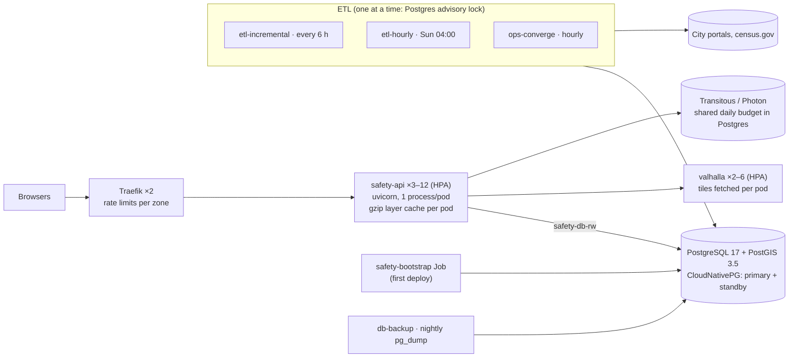

# Kubernetes deployment

How the site runs on Kubernetes: horizontally scaled, portable across clouds, tested on the
[FABRIC testbed](https://fabric-testbed.net). The home server (docs/DEPLOYMENT.md) is unchanged by
any of this; the two can run side by side.

Contents: [Layout](#layout) · [Why this shape](#why-this-shape) · [Node layout](#node-layout) ·
[First deploy](#first-deploy) · [Keeping data current](#keeping-data-current) ·
[Updating](#updating) · [Load testing](#load-testing) · [Other clouds](#other-clouds) ·
[Runbook](#runbook)

FABRIC step by step: [`deploy/fabric/README.md`](../deploy/fabric/README.md).

---

## Layout



Everything lives in the `safety` namespace, from `deploy/k8s/`:

| Path | What |
|---|---|
| `base/` | The cloud-neutral manifests: config, database cluster, API, Valhalla, ETL CronJobs, backups, ingress, network policies |
| `jobs/` | The migrate and bootstrap Jobs (rendered per release by `deploy.sh`, because Jobs are immutable) |
| `overlays/fabric`, `fabric-small` | k3s on a FABRIC slice (`deploy/fabric/create_slice.py`) |
| `overlays/aws`, `overlays/azure` | EKS and AKS: storage classes, pod CIDR, Traefik values |
| `overlays/local` | One machine (k3d, kind): one of everything, Philadelphia only, one month |
| `deploy.sh` | Operator, overlay, database, migrate, rollouts, bootstrap, smoke, in order |
| `loadtest/` | In-cluster k6 load test |

| Workload | Kind | Replicas | Requests → limits | Placement |
|---|---|---|---|---|
| `safety-api` | Deployment + HPA (CPU 65 %) + PDB | 3 → 12 | 0.5 CPU / 768 Mi → 1.5 CPU / 1.5 Gi | `safety.io/tier=app`, spread across nodes |
| `valhalla` | Deployment + HPA (CPU 70 %) + PDB | 2 → 6 | 0.5 CPU / 512 Mi → 1.5 CPU / 1.5 Gi | `tier=app` |
| `safety-db` | CloudNativePG `Cluster` | 2 (primary + standby) | 2 CPU / 12 Gi, 60 Gi volume each | `tier=data`, one per node |
| `etl-incremental`, `etl-hourly`, `ops-converge` | CronJob | 1, never overlapping | 0.5 CPU / 1 Gi → 2 CPU / 6 Gi | `tier=data` |
| `safety-bootstrap`, `safety-migrate` | Job | 1 | as the ETL | `tier=data` |
| `db-backup` | CronJob, 02:30 UTC | 1 | small | anywhere |
| Traefik | k3s's bundled chart (Helm on clouds) | 2 | 0.2 CPU / 128 Mi | anywhere |

## Why this shape

**The request path never computes.** Every map layer is precomputed by the ETL into `gold.*`
(docs/ARCHITECTURE.md), and each API pod keeps the layers it has served as gzipped bytes. A visitor's
map load is a cache hit: a dictionary lookup and a write of bytes already compressed. Scaling the
site is therefore scaling those pods, plus making sure that a hit costs the database nothing:

- **Stamp memo.** A cached layer is valid while its city's `last_refreshed_at` is unchanged, and on
  the home server every hit re-reads that stamp. With thousands of visitors that one query per hit
  would be most of the database's load, so pods trust a stamp for `CACHE_STAMP_TTL_SECONDS` (5).
  A new ETL snapshot reaches the map at most 5 s later.
- **Warm start.** `CACHE_WARM_ON_START` builds `/cities` and each city's default layer as a pod
  starts, so the autoscaler's new pods do not give their first visitors a cold multi-second build.

**One uvicorn process per pod.** The cache, the rate limiter and the pool are per process. With
several workers in one pod they would be multiplied inside the pod with no way to see it. With one
process per pod, Kubernetes' own scaling, probes and metrics describe exactly what is running.

**Sizing.** At 5,000 open tabs, the `/version` poll alone (once a minute per tab) is about
85 requests/s, and map loads arrive in bursts on top of it. Three pods carry that with headroom. The
HPA adds pods at 65 % CPU up to twelve, and waits five minutes before removing any, because a new pod
starts with a cold cache. The real ceiling on `/cells` is bandwidth (a city layer is several hundred
KB gzipped), which is what a CDN in front would take next. The database sees at most 12 × 8 API
connections plus one ETL job, well within its `max_connections` of 200.

**What had to change in the app** to be safe with N replicas:

| Was per process | Now |
|---|---|
| Transitous / Photon daily budgets: N pods would spend N× the allowance, refilled on every restart | `ROUTING_BUDGET_BACKEND=db`: one atomic counter per provider per UTC day (`public.provider_budget`, migration 023). It refuses when it cannot count. |
| ETL mutual exclusion: a `flock` on a file in the instance directory | `python -m safety.joblock -- <cmd>`: a Postgres advisory lock, held for the run, released if the pod dies |
| Pool fixed at 8 | `API_POOL_MAX_SIZE` |
| New code could meet an old schema | API pods wait in an init container until every migration they ship is applied (`safety.schemawait`) |

Left per pod, deliberately:
- **The response cache.** Correct per pod (validated against the database stamp); a shared Redis
  would save each pod one build per layer per refresh, which is not worth a new stateful service.
- **The in-app rate limiter.** Traefik applies the same zones in front of it.
- **Circuit breakers and provider caches.** Each pod trips its own breaker after three failures.

**The database.** CloudNativePG runs PostGIS with a streaming standby on a second node and fails
over automatically. Its `safety-db-rw` Service always points at the primary. It creates the
non-superuser owner role the app expects (`safety_app`) and generates its password into the
`safety-db-app` Secret, so no credentials are written anywhere by hand. The operator is the same on
every provider. On a cloud you can instead point the app at a managed PostgreSQL with PostGIS (RDS,
Azure Database for PostgreSQL Flexible Server): replace the Cluster with a Secret named
`safety-db-app` (keys `username`, `password`, `dbname`) and set `POSTGRES_HOST`.

**Ingress.** Traefik, because k3s ships it and it installs the same way on EKS and AKS.
ingress-nginx, the closest match to the home server's nginx, was retired upstream in March 2026. The
nginx limits from `deploy/nginx/safety.conf` become Traefik middlewares, one Ingress per zone:

| Path | Limit per client address |
|---|---|
| `/api/v1/cells` (exact) | 2 r/s, burst 10 |
| `/api/v1/directions` (exact) | 30 r/min, burst 6 |
| `/api/v1/geocode*` | 3 r/s, burst 10 |
| other `/api/v1/*` | 10 r/s, burst 20 |
| everything | 20 concurrent requests |

uvicorn believes `X-Forwarded-For` / `-Proto` only from `FORWARDED_ALLOW_IPS`, the ingress
controller's pod CIDR. That keeps the rate-limit key honest, and HSTS appears once the edge
terminates TLS.

## Node layout

The FABRIC slice (`deploy/fabric/create_slice.py`, profile `standard`) is five VMs at one site on a
private L2 network:

| VM | Size | Role | Runs |
|---|---|---|---|
| `cp1` | 4 cores / 8 GB / 60 GB | k3s server | control plane, Traefik, CloudNativePG operator, CoreDNS, metrics-server |
| `data1`, `data2` | 8 / 32 / 150 | `safety.io/tier=data`, taint `dedicated=data:NoSchedule` | database primary and standby, ETL, backups |
| `app1`, `app2` | 8 / 16 / 60 | `safety.io/tier=app` | API pods, Valhalla |

Data nodes are tainted so a burst of API pods can never take the database's memory. The database and
the ETL are the only things that tolerate the taint. App nodes have the CPU, which is what the API
and routing need. With two of each, losing any one VM leaves the site up: the standby is promoted,
and the API and Valhalla each keep at least one pod.

The same labels and taint are how node pools are laid out on EKS and AKS. The base manifests only
*prefer* the labels, so an unlabelled cluster still schedules everything. The FABRIC overlay
*requires* them.

## First deploy

`deploy.sh <overlay> [image]` does, in order (each step waits for the last):

1. installs the CloudNativePG operator (pinned, 1.30.1) if the cluster lacks it;
2. applies the overlay;
3. waits for the database (initdb, PostGIS created by the superuser);
4. runs the `safety-migrate` Job: all migrations, as the non-superuser owner;
5. waits for the API and Valhalla rollouts (each Valhalla pod first downloads about 1.2 GB of tiles);
6. starts the `safety-bootstrap` Job unless it has already completed;
7. smoke-tests through a port-forward with `deploy/lib/smoke.sh`, checking the commit when the image
   is tagged by commit.

**The bootstrap** (`python -m safety.bootstrap`):
- runs migrate;
- enables every city in `BOOTSTRAP_CITIES` (default `phl,chi,sea,lax,dc,aus`) with the existing
  `safety.etl.run enable`, readiness checks included;
- runs `safety.ops` under the ETL lock.

ops works out what each city is missing and does it in order: a `BACKFILL_MONTHS`-deep backfill (12,
set in the ConfigMap), census blocks and jobs, gold, and the time-of-day layers. Each city appears
on the map as soon as its own load is done. The whole first load is one to a few hours, mostly spent
waiting on the city portals. If the pod is killed, the Job retries and ops carries on from what the
data says is still missing. `OPS_RETRY_COOLDOWN_HOURS=0` on the Job stops the retry from waiting
behind the killed pod's ledger row.

The full-history load (`history_enabled`) stays off, so nothing loads further back than 12 months.
With about a year stored, gold builds the `last_3m`, `last_6m`, `last_9m` and `last_1y` windows.

> Austin: docs/DEPLOYMENT.md asks for the City of Austin's reuse terms to be confirmed before enabling
> `aus` on a new host. To leave it off, set `BOOTSTRAP_CITIES` to the other five in
> `base/config.yaml` before the first deploy, or later run
> `kubectl -n safety exec deploy/safety-api -- python -m safety.etl.run enable --city aus --off`.

All data lives in the cluster: incidents, gold and census in the database volumes, raw pulls in the
`bronze` volume, and nightly dumps in `db-backups`.

## Keeping data current

The CronJobs run the home server's timers, with the same commands, each wrapped in the ETL lock:

| CronJob | Schedule (UTC) | Command |
|---|---|---|
| `etl-incremental` | every 6 h | `safety.etl.run incremental --all --due-only --skip-hourly` |
| `etl-hourly` | Sundays 04:00 | `safety.etl.run hourly --all` |
| `ops-converge` | hourly at :20 | `safety.ops` (whatever an enabled city is missing) |
| `db-backup` | 02:30 | `pg_dump -Fc`, newest seven kept |

A job that finds another holding the lock waits (`JOBLOCK_WAIT_SECONDS`) and gives up with exit 75
if it never frees, so the next tick runs instead.

## Updating

Push to `horizontal-scaling` (or `main`/`testing`). `.github/workflows/image.yml` validates the
manifests, builds the image, checks its paths and commit, and pushes
`ghcr.io/ryanfio15/crime-prevention-and-personal-safety-application:<sha>` and `:<branch>`. Then:

```bash
deploy/k8s/deploy.sh fabric ghcr.io/ryanfio15/crime-prevention-and-personal-safety-application:<full sha>
```

Migrations run before new API pods serve (they wait for them), and the rollout replaces pods one at
a time with no downtime. Migrations must stay expand/contract, exactly as on the home server
(docs/DEPLOYMENT.md, "Migrations during a deploy"), because old pods keep serving while new ones
start. The bootstrap is not run again; `RERUN_BOOTSTRAP=1` forces it.

## Load testing

```bash
deploy/k8s/loadtest/run.sh 3000      # virtual users at peak; about 9 minutes
kubectl -n safety get hpa -w         # meanwhile, in another shell
```

Each virtual user does what a browser does: `/cities`, a city's map layer, then a `/version` poll
every 20 s, three times as often as the real page. The test hits the API Service directly and turns
the in-app rate limiter off for the run, because every virtual user comes from one pod and would
otherwise share one client's limit. It passes when fewer than 1 % of requests fail and p95 is under
300 ms for `/cities`, `/cells` and `/version`.

## Other clouds

The manifests are the same everywhere; an overlay changes only what the provider decides.

**AWS (EKS)** (`overlays/aws`):
1. Create node groups labelled `safety.io/tier=app` (e.g. 2–4 × m7i.2xlarge) and
   `safety.io/tier=data` with taint `dedicated=data:NoSchedule` (2 × r7i.xlarge).
2. Install the EBS CSI driver add-on, metrics-server and the AWS Load Balancer Controller.
3. Install Traefik:
   `helm install traefik traefik/traefik -n traefik --create-namespace -f deploy/k8s/overlays/aws/traefik-values.yaml`
   (an NLB with IP targets, so the visitor's address reaches the rate limits).
4. Set `FORWARDED_ALLOW_IPS` in the overlay to your VPC CIDR.
5. Run `deploy/k8s/deploy.sh aws <image>`.

**Azure (AKS)** (`overlays/azure`): the same with node pools (Standard_D8s_v5 for app,
Standard_E4s_v5 for data) and `overlays/azure/traefik-values.yaml`. AKS has metrics-server and the
`managed-csi-premium` StorageClass built in. Set `FORWARDED_ALLOW_IPS` to the cluster's pod CIDR.

For either cloud:
- **Public site:** add a `host` and `tls` to the Ingresses (cert-manager, or the provider's
  certificates).
- **Backups:** switch to CloudNativePG's object-store backups (S3 or Azure Blob), which add WAL
  archiving and point-in-time recovery.
- **CDN:** put one in front for `/` and `/api/v1/cells`. Those responses already carry
  `Cache-Control: max-age=60`.

## Runbook

| Task | Command |
|---|---|
| What is running where | `kubectl -n safety get pods -o wide` |
| First-load progress | `kubectl -n safety logs -f job/safety-bootstrap` |
| City status, pulls, data quality | `kubectl -n safety exec deploy/safety-api -- python -m safety.etl.run status` |
| Run convergence now | `kubectl -n safety create job --from=cronjob/ops-converge ops-now` |
| Pull new data now | `kubectl -n safety create job --from=cronjob/etl-incremental pull-now` |
| Enable / disable a city | `kubectl -n safety exec deploy/safety-api -- python -m safety.etl.run enable --city <id> [--off]` |
| Database health, failover state | `kubectl -n safety get cluster safety-db`; `kubectl cnpg status safety-db -n safety` with the cnpg plugin |
| psql as the app role | `kubectl -n safety exec -it safety-db-1 -- psql -U safety_app safety` (use whichever pod is primary) |
| Copy last night's dump off the cluster | start a pod mounting `db-backups`, then `kubectl cp` |
| Scale by hand | `kubectl -n safety scale deploy/safety-api --replicas=6` (the HPA keeps its own min/max) |
| Roll back the API | `kubectl -n safety rollout undo deploy/safety-api` (migrations stay applied: expand/contract) |
