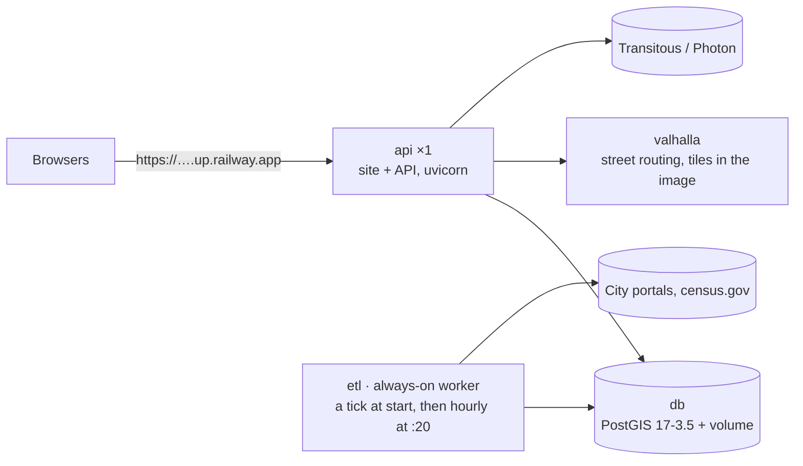

# Railway deployment

The whole site on [Railway](https://railway.com) with one API instance and a public HTTPS address. The data is kept
current by a background worker until the project is deleted. The backend and frontend are the same as the Kubernetes
deployment's (docs/KUBERNETES.md); only the hosting differs.

There are two ways in. Both build exactly the same project:

| | For | What it takes |
|---|---|---|
| **[One-click template](#one-click-deploy)** | Anyone, no terminal | A Railway account and one **Deploy** button |
| **[Command line](#command-line-deploy)** | Maintainers, CI | `railway login`, then `deploy/railway/up.sh` |

The template has to be made once, by a maintainer, before anyone can use the button:
[Making the template](#making-the-template).

Contents: [What it builds](#what-it-builds) · [One-click deploy](#one-click-deploy) ·
[Making the template](#making-the-template) · [Command-line deploy](#command-line-deploy) ·
[Everyday tasks](#everyday-tasks) · [How it works](#how-it-works) · [What was tested](#what-was-tested) ·
[Troubleshooting](#troubleshooting)

---

## What it builds



One Railway project with four services, all built from this repository:

| Service | Built from | Runs | Volume | Public |
|---|---|---|---|---|
| `db` | `deploy/railway/db.Dockerfile` | PostgreSQL 17 + PostGIS 3.5, as the `safety_app` owner role | `/var/lib/postgresql/data` | no |
| `api` | `Dockerfile` | `deploy/railway/start-api.sh`: wait for the database, migrate, serve. **One replica** | none | **yes** |
| `valhalla` | `deploy/railway/valhalla.Dockerfile` | drive / walk / bike routing, tiles built into the image | none | no |
| `etl` | `Dockerfile` | `deploy/railway/etl_tick.py --loop`: one tick at start, then hourly | `/data` (bronze) | no |

Each city keeps exactly one rolling year of data, as on every other deployment (docs/OPERATIONS.md, "One year of
data").

Railway bills by use, so the account needs a payment method. The database (several GB) and the API are always on.
The worker idles at a few tens of MB and needs a few GB of memory only during the first load. Plan on the Pro plan
if Hobby's limits get in the way.

---

## One-click deploy

For anyone. No terminal, no settings.

1. Click **Deploy on Railway** (the button in the README, once the template is published).
2. Sign in to Railway, or create an account, and add a payment method if asked.
3. Click **Deploy**. Every password is generated for this deployment, and nothing else needs filling in.
4. Wait 10–20 minutes while the four services build. The routing service downloads about 1.2 GB of map tiles, and
   the database's first start takes a few minutes.
5. Open the **api** service → **Settings** → **Networking**. The `….up.railway.app` address there is the site, ready
   to share.

The data then loads by itself. Open the site straight away: the map shows a progress bar with the time left, and
each city appears as soon as its own load finishes. The whole first load takes one to a few hours. After that the
worker checks every hour for new incidents and deletes anything older than a year, with no further action.

**Choosing cities.** The `BOOTSTRAP_CITIES` variable on the **etl** service lists the cities the first start switches
on (default `phl,chi,sea,lax,dc,aus`). Edit it on the deploy screen, or right after deploying, before the first load
has started. docs/DEPLOYMENT.md asks for the City of Austin's reuse terms to be confirmed before `aus` is shown
publicly; `phl,chi,sea,lax,dc` leaves it out.

**Taking it down.** Project → **Settings** → **Danger** → **Delete project**. This deletes the site and its data, and
billing stops.

---

## Making the template

For maintainers, once, and again only when the services or their variables change. Code changes need no new
template, because deployed copies build from the branch.

A Railway template can only be written in the dashboard's composer or generated from an existing project. There is
no file format for one. `make-template.sh` therefore builds the project and generates the template from it:

```bash
railway login                              # once per machine
git push origin railway-deployment         # the template builds from GitHub, not your checkout
deploy/railway/make-template.sh            # --branch <name> for another branch
```

It works in three steps:

1. **Reference project.** It runs `up.sh --github railway-deployment` to create a project named
   `safety-map-template` whose four services build from this repository on GitHub. Its id is kept in
   `deploy/railway/.template-project-id`, which git ignores.
2. **Template draft.** Railway's `templateGenerate` copies that project into an unpublished draft.
3. **Check.** It compares the draft with what a deployer needs and prints one line per item, `ok` or `FIX`, with
   what to change:

   ```
     ok   api start command
     FIX  db POSTGRES_PASSWORD is generated per deployment
          -> set it to ${{secret(48, "abcdef0123456789")}} -- otherwise every deployment shares this project's password
   ```

Then, in the dashboard (workspace → **Templates** → `safety-map-template`):

1. **Fix every `FIX` line** in the composer. Expect at least the two database passwords: a draft generated from a
   project copies that project's values, and each deployment needs its own.
   - Set `POSTGRES_PASSWORD` and `SAFETY_APP_PASSWORD` on **db** to `${{secret(48, "abcdef0123456789")}}`. Hex only,
     because the password ends up inside a connection URL.
2. **Optional:** add descriptions to `BOOTSTRAP_CITIES` and `SOCRATA_APP_TOKEN` (etl). These are what deployers see.
3. **Publish.** This makes the template **public** on Railway's marketplace. Use the **Publish** button, or the
   command `make-template.sh` prints, which uses `deploy/railway/TEMPLATE.md` as the marketplace page.
4. **Add the button** that `make-template.sh` printed to the README:

   ```markdown
   [](https://railway.com/new/template/<code>?utm_medium=integration&utm_source=button&utm_campaign=safety-map)
   ```

The reference project can stay as the template's live demo (`--demo-project` on publish), or be deleted with
`deploy/railway/down.sh --template`.

### What a template carries, and why the services are built the way they are

A template stores each service's source, variables, start command, health check, volumes and public domain. It does
**not** store a cron schedule, a restart policy or the Dockerfile path setting. Railway's own cron template tells
deployers to set the schedule by hand after deploying. So nothing here depends on those:

- **No cron.** The `etl` service is an always-on worker that schedules its own hourly ticks
  (`etl_tick.py --loop`).
- **Dockerfile paths in variables.** Every service has its Dockerfile in the `RAILWAY_DOCKERFILE_PATH` variable,
  which Railway reads at build time.
- **No restart policy needed.** Railway's default (restart on failure) is right for all four services.

---

## Command-line deploy

The same project without the template: for maintainers, CI, or trying a change before it is pushed (it uploads the
working tree rather than building from GitHub).

**You need:**
- the Railway CLI: `npm i -g @railway/cli` (tested with 5.74.0);
- `curl`, `jq` and `openssl`;
- this repository checked out.

Log the CLI in once per machine with `railway login`; on a machine without a browser, use
`railway login --browserless`. In CI, export `RAILWAY_API_TOKEN` (an account token from
[railway.com/account/tokens](https://railway.com/account/tokens)) instead. Keep it private: it can create and
delete projects.

```bash
export SOCRATA_APP_TOKEN=<optional>     # faster first load for the four Socrata cities
deploy/railway/up.sh
```

The script:
1. creates a Railway project (`safety-map`) and keeps its id in `deploy/railway/.project-id`, which git ignores;
2. creates the four services, both volumes and every variable, generating the database passwords;
3. sets each service's start command and health check;
4. uploads the checkout and builds and deploys `db`, `valhalla`, `api` and `etl` (10–20 minutes);
5. gives `api` a public `https://….up.railway.app` address and prints it.

The worker's first tick then starts the data load.

**Updating:** run the same command again. It updates the same project in place: settings and variables are
re-applied and every service is rebuilt from the working tree. Passwords and data are kept. Rerunning also picks up
each month's new routing tiles.

**Taking it down:** `deploy/railway/down.sh` asks you to type the project name, then deletes the whole project and
its data. Billing stops with it. Accounts with two-factor authentication:
`RAILWAY_2FA_CODE=123456 deploy/railway/down.sh`.

| Option | Effect |
|---|---|
| `--name <name>` | Project name for a new project (default `safety-map`) |
| `--workspace <id or name>` | Railway workspace for a new project |
| `--cities phl,chi,...` | Which cities the first start switches on (default all six) |
| `--no-routing` | No `valhalla` service: drive, walk and bike directions show as unavailable; the map, transit and search keep working |
| `--config-only` | Re-apply settings and variables without rebuilding anything |
| `--github <branch>` | Build from this repository on GitHub instead of uploading (what `make-template.sh` uses) |

---

## Everyday tasks

| Task | In the dashboard | From the command line |
|---|---|---|
| Find the site's address | **api** → Settings → Networking | `railway domain --service api` |
| Watch the data load | **etl** → Deployments → View logs | `railway logs --service etl` |
| Site logs | **api** → Deployments → View logs | `railway logs --service api` |
| Run a data tick now | **etl** → ⋯ → Restart | `railway restart --service etl --yes` |
| City status, data quality | — | `railway ssh --service api -- python -m safety.etl.run status` |
| Turn a city off | — | `railway ssh --service api -- python -m safety.etl.run enable --city <id> --off` |
| Turn a city on | — | `railway ssh --service api -- python -m safety.etl.run enable --city <id>` (the next tick loads it) |
| Health | open `https://<address>/api/v1/health` | `curl -s https://<address>/api/v1/health` |

Restarting `etl` in the middle of a load is safe. It stops the running step cleanly, and the next tick picks up from
what the data says is still missing.

---

## How it works

**The worker, not a cron job.** Kubernetes runs three CronJobs and a bootstrap Job. On Railway they are one always-on
service, for two reasons:
- a volume attaches to one service only, so separate jobs would mean separate bronze archives;
- a template cannot carry a cron schedule.

`etl_tick.py --loop` runs a tick as soon as it starts, then one every hour at :20 UTC, sleeping in between. Each
step runs as its own subprocess, so the memory a census load needs is returned when it finishes. The Kubernetes
commands run unchanged:

| Kubernetes | Railway (`etl_tick.py`) |
|---|---|
| `safety-bootstrap` Job, once | First tick only: `safety.bootstrap --skip-migrate --skip-converge` enables `BOOTSTRAP_CITIES`, then a marker on the volume stops it repeating. A city switched off later stays off |
| `ops-converge`, hourly | Every tick: `safety.ops` |
| `etl-incremental`, every 6 h | Every tick: `incremental --all --due-only --skip-hourly`. `--due-only` asks each city's cadence, so a city is pulled no more often than before |
| `etl-hourly`, daily 04:00 | Once per UTC day at or after 04:00, remembered on the volume, so a day whose 04:20 tick fell inside a long load still gets it |
| ETL advisory lock | Unchanged (`safety/joblock.py`), held for the whole tick |

Ticks behave as follows:
- A tick that runs past the next :20 (the first load does) is followed by the next :20 after it ends, never by a
  backlog.
- A failed step doesn't stop the next one.
- SIGTERM, which Railway sends on a redeploy or restart, is passed to the running step, which stops cleanly. The
  worker then exits.

**The database.** It is the same PostGIS image as `docker-compose.yml`, with two additions from `db.Dockerfile`:
- server settings sized for a database of about 7 GB;
- a first-start script (`db-init.sh`) that creates `safety_app`, a non-superuser that owns the database, as
  CloudNativePG does on Kubernetes.

The image's own init has already created PostGIS by then, so every migration runs as `safety_app`. The other
services read `safety_app`'s password through a Railway reference (`${{db.SAFETY_APP_PASSWORD}}`). The data directory
is `pgdata/` inside the volume, because a fresh volume is not empty and `initdb` refuses a non-empty directory.

**One API.** The settings are the Kubernetes ConfigMap's:
- the response cache trusts a city's refresh stamp for 5 s;
- it warms the default layers on start;
- provider budgets are counted in Postgres, so a restart does not refill them.

The API migrates the database as it starts. Railway keeps the old version serving until the new one passes its
health check, so migrations must stay expand/contract (docs/DEPLOYMENT.md, "Migrations during a deploy"). One uvicorn
process carries a few thousand open tabs, because the map layers are precomputed (docs/KUBERNETES.md, "Why this
shape"). Every setting already supports more replicas.

**Routing tiles in the image.** Kubernetes downloads the tiles in an init container. Railway has none, so
`valhalla.Dockerfile` runs the same verified download (`scripts/fetch_valhalla_tiles.py`) in a build stage, for the
release named by `VALHALLA_TILES_TAG`:
- `up.sh` sets it to the newest release;
- a template deployment uses the newest one at build time.

**Rate limiting.** There is no Traefik or nginx in front, so the app's own limiter (`safety/api/ratelimit.py`) does
the work, keyed on the client address uvicorn takes from Railway's proxy headers. `FORWARDED_ALLOW_IPS` stays `*`,
because Railway's proxy address range is not published (see the `Dockerfile` comment for the trade-off).

**Why a script, not a Railway config file.**
- Railway's config-as-code files (`railway.toml`/`railway.json`) are deprecated and stop working on 2026-12-01.
- Their successor (`.railway/railway.ts`) has no start command, Dockerfile path or restart policy.
- `up.sh` sets those through Railway's public GraphQL API, by way of `railway api`, so the CLI's login is the only
  credential.

---

## What was tested

Verified on 2026-11-14:

- **Locally, with Docker:**
  - The `db` image's first start creates `safety_app`.
  - `start-api.sh` applies all 24 migrations as that non-superuser and serves `/api/v1/health` (HTTP 200) as the
    unprivileged `safety` account.
  - The worker started before the API waits for the schema rather than crashing, then runs its first tick: it
    enables the cities and writes its marker.
  - A restarted worker skips the bootstrap.
  - SIGTERM stops the worker cleanly with exit 0, both while it sleeps (0.3 s) and in the middle of a real
    Philadelphia download (under 10 s).
  - The next-tick time is right, including across midnight, and the daily rebuild runs once per day.
  - The `valhalla` image builds with the newest tiles and answers a walking route across central Philadelphia.
- **Against a stand-in Railway CLI and API:**
  - `up.sh`, in both upload and `--github` modes, creates, then reruns with no duplicate services, volumes or
    domains, and keeps its passwords.
  - `make-template.sh` builds the reference project from GitHub and generates the draft. Its checker passes a
    faithful copy except for the two passwords, and flags each item a lossy copy drops.
  - `down.sh`, including `--template`, refuses without the exact project name.
- **Against Railway itself:**
  - Every CLI flag used matches Railway CLI 5.74.0.
  - Every GraphQL query, mutation, argument and input field used exists in the live schema.
  - `railway api` works with only a browser login.
  - Published templates' stored configuration confirms what a template carries: start command, health check,
    volumes, variables with descriptions and `${{secret()}}` defaults, and no cron schedule.

Not yet verified against a live Railway project:
- exactly what `templateGenerate` copies (`make-template.sh` checks the draft and says what to fix);
- the exact JSON `railway init --json` prints (the script falls back to `railway status --json`);
- whether a deployed template copy redeploys by itself when the branch changes, or needs **Redeploy** in its
  dashboard;
- `railway ssh` running a one-off command as written above.

The first `make-template.sh` run is the remaining test.

---

## Troubleshooting

| Symptom | Likely cause | Fix |
|---|---|---|
| `not logged in to Railway` | The CLI has no login on this machine | `railway login`, then rerun |
| `unset RAILWAY_TOKEN` | A project token is set in the shell; it cannot create projects | `unset RAILWAY_TOKEN` and rerun |
| `Railway API: Not Authorized` | Logged in to a different account, or the project is in a workspace you can't manage | `railway whoami`; `railway logout` and `railway login` as the right account |
| `make-template.sh: branch … is not on origin` | The template builds from GitHub | `git push origin <branch>` first |
| `api` logs `database not ready (attempt N/600)` for minutes | The database's first start (initdb) | Wait; the API waits up to 20 minutes and its health check allows 25 |
| `api` crash-loops with `password authentication failed` | The `db` volume was initialised with other passwords | Don't change the passwords by hand after the first deploy; on a brand-new project, delete it and deploy again |
| Map empty, no progress bar after 30 minutes | The worker's first tick is waiting or failing | **etl** logs; `schemawait: waiting` means the API hasn't migrated yet, so check the **api** logs |
| A worker tick reports failures | One step failed, often a city portal's bad day | **etl** logs; the next hourly tick retries |
| Directions say drive/walk/bike unavailable | `valhalla` is down or was left out (`--no-routing`) | **valhalla** logs |
| `429 Too Many Requests` | The per-client rate limit, working as intended | Nothing; normal use never reaches it |
