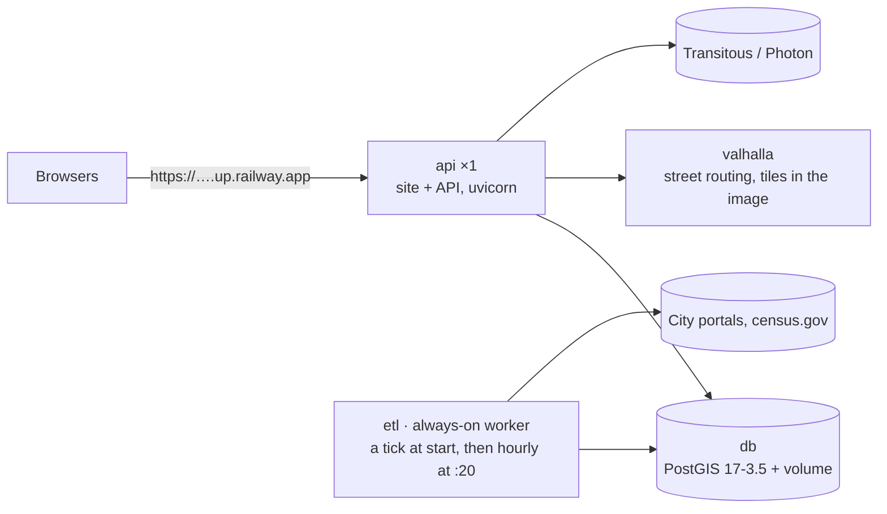

# Railway deployment

The whole site on [Railway](https://railway.com) with one API instance and a public HTTPS address, deployed with one
command from a checkout. The data is kept current by a background worker until the project is deleted. The backend
and frontend are the same as the Kubernetes deployment's (docs/KUBERNETES.md); only the hosting differs.

Everything here goes through the Railway CLI and its login, so there is no token to create or paste:

```bash
railway login
deploy/railway/up.sh --cities phl,chi,sea,lax,dc,aus
```

[Deploying](#deploying) is that command in full — prerequisites, what it prints, and how to confirm the site is
serving and the data is loading.

Contents: [What it builds](#what-it-builds) · [Deploying](#deploying) · [Everyday tasks](#everyday-tasks) ·
[Updating](#updating) · [Taking it down](#taking-it-down) · [`up.sh` options](#upsh-options) ·
[How it works](#how-it-works) · [What was tested](#what-was-tested) · [Troubleshooting](#troubleshooting)

---

## What it builds



One Railway project with four services, all built from this repository:

| Service | Built from | Runs | Volume | Public |
|---|---|---|---|---|
| `db` | `deploy/railway/db.Dockerfile` | PostgreSQL 17 + PostGIS 3.5, as the `safety_app` owner role | `/var/lib/postgresql/data` | no |
| `api` | `Dockerfile` | `deploy/railway/start-api.sh`: wait for the database, migrate, serve. **One replica** | none | **yes** |
| `valhalla` | `deploy/railway/valhalla.Dockerfile` | drive / walk / bike routing, tiles built into the image | none | no |
| `etl` | `Dockerfile` | `deploy/railway/etl_tick.py --loop`: one tick at start, then hourly | `/data` (bronze) | no |

Each city keeps exactly one rolling year of data, as on every other deployment (docs/OPERATIONS.md, "One year of
data").

Railway bills by use, so the account needs a payment method. The database (several GB) and the API are always on.
The worker idles at a few tens of MB and needs a few GB of memory only during the first load. Plan on the Pro plan
if Hobby's limits get in the way.

---

## Deploying

Start to finish: one command deploys, the rest is watching it come up. Steps 1–3 take about ten minutes of your
time; steps 4–6 are waiting, and the site is live and loading data throughout. All six cities are the default, so
nothing has to be passed to get them.

### 1. Install what it needs

| | Check |
|---|---|
| Railway CLI (tested with 5.74.0) | `npm i -g @railway/cli` → `railway --version` |
| `curl`, `jq`, `openssl` | `curl --version && jq --version && openssl version` |
| This repository, checked out | `git clone …` → `cd Crime-Prevention-and-Personal-Safety-Application` |

On Windows, run everything from **Git Bash**, not PowerShell or `cmd`: the scripts are bash. `jq` and `openssl`
come with Git for Windows; `curl` is in Windows itself.

Run every command below from the repository root. The scripts find the repository from their own path, so
`deploy/railway/up.sh` works from anywhere, but `railway logs` and friends want the linked project, which `up.sh`
leaves set in this directory.

### 2. Log in and check the account

```bash
railway login            # opens a browser; --browserless on a machine without one
railway whoami           # confirm it is the account that should own the project
unset RAILWAY_TOKEN      # a *project* token cannot create projects; up.sh refuses if one is set
```

In CI, export `RAILWAY_API_TOKEN` (an account token from
[railway.com/account/tokens](https://railway.com/account/tokens)) instead of logging in. Keep it private: it can
create and delete projects.

The account needs a payment method on file, and enough plan headroom for an always-on database of several GB
(see [What it builds](#what-it-builds)). Railway refuses the deploy otherwise, usually with a quota error on the
first build.

### 3. Deploy

```bash
export SOCRATA_APP_TOKEN=<optional>     # faster first load for the four Socrata cities
deploy/railway/up.sh --cities phl,chi,sea,lax,dc,aus
```

`--cities` is the default, written out: all six cities, switched on by the worker's first tick. Drop `aus` if the
City of Austin's reuse terms have not been confirmed for a public deployment (docs/DEPLOYMENT.md).

The script runs for 10–20 minutes and prints a `==>` heading per stage:

| Stage | What happens |
|---|---|
| `creating Railway project 'safety-map'` | Creates the project, saves its id in `deploy/railway/.project-id` (git-ignored), and links this directory to it |
| `services` | Creates `db`, `api`, `valhalla`, `etl` and the two volumes |
| `variables` | Generates the two database passwords, sets every service's variables including `BOOTSTRAP_CITIES` |
| `service settings` | Start commands, health check, Dockerfile paths, restart policy |
| `building and deploying db / valhalla / api / etl` | Uploads the working tree and builds each one, in that order |
| `public URL` | Gives `api` its `https://….up.railway.app` address |

It ends with `Done.` and the site's address. **If it stops before `Done.`, nothing further runs on its own** —
fix what it reported ([Troubleshooting](#troubleshooting)) and run the same command again; it picks up the same
project and skips what already exists.

### 4. Watch the four services come up

`up.sh` returns as soon as each build is handed to Railway; the builds themselves finish afterwards. Watch them:

```bash
railway logs --service db          # "database system is ready to accept connections"
railway logs --service valhalla    # downloads ~1.2 GB of tiles into the image: slowest build
railway logs --service api         # waits for db, applies migrations, then uvicorn
railway logs --service etl         # the worker
```

Or open the project (`https://railway.com/project/<id>`, printed at the end) and watch all four tiles turn green.
Expect in this order, over roughly 10–25 minutes:

1. **db** — the first start runs `initdb` on the empty volume: several minutes, then `safety_app` is created.
2. **valhalla** — the long build. The map, transit and search do not wait on it; only directions do.
3. **api** — logs `database not ready (attempt N/600)` until `db` is up, then applies all migrations, then serves.
   Its health check allows 25 minutes for exactly this.
4. **etl** — logs `worker started: a tick now, then hourly at :20 UTC`, then `safety.schemawait`, which waits for
   `api`'s migrations before anything else.

### 5. Confirm the site is up

```bash
railway domain --service api                      # the address, if you lost it
curl -s https://<address>/api/v1/health           # {"status":"ok",...}
```

Open `https://<address>` in a browser. The map loads immediately and shows a progress bar: there is no data yet.

### 6. Confirm the ETL started with all six cities

The first tick is what enables the cities. In `railway logs --service etl`, look for this sequence:

```
etl_tick: worker started: a tick now, then hourly at :20 UTC
etl_tick: 2026-11-16 14:03 UTC: bootstrap=yes, ops=yes, incremental=yes (due cities only), hourly=yes
etl_tick: running safety.schemawait --timeout 1800
etl_tick: running safety.bootstrap --skip-migrate --skip-converge    <- enables the six cities
etl_tick: running safety.ops                                          <- the one-year load begins
```

`bootstrap=yes` only ever appears on the first tick: it writes a marker on the volume, so a city switched off later
is not switched back on. Then check the registry:

```bash
railway ssh --service api -- python -m safety.etl.run status
```

All six — `phl`, `chi`, `sea`, `lax`, `dc`, `aus` — should be listed as enabled. If `railway ssh` is unavailable,
the **api** service's dashboard shell does the same. A city that fails its readiness check (usually a missing
crosswalk) is reported and left off rather than forced on; switch it on once that is fixed:

```bash
railway ssh --service api -- python -m safety.etl.run enable --city aus
```

The next hourly tick picks it up. Nothing else has to be started: `safety.ops` is already loading, and each city
appears on the map as soon as its own year of data lands. The whole first load takes one to a few hours, mostly
waiting on the city portals. After that the worker ticks hourly at :20 UTC, pulling what is due and deleting
anything older than a year, with no further action.

---

## Everyday tasks

| Task | In the dashboard | From the command line |
|---|---|---|
| Find the site's address | **api** → Settings → Networking | `railway domain --service api` |
| Watch the data load | **etl** → Deployments → View logs | `railway logs --service etl` |
| Site logs | **api** → Deployments → View logs | `railway logs --service api` |
| Run a data tick now | **etl** → ⋯ → Restart | `railway restart --service etl --yes` |
| City status, data quality | — | `railway ssh --service api -- python -m safety.etl.run status` |
| Turn a city off | — | `railway ssh --service api -- python -m safety.etl.run enable --city <id> --off` |
| Turn a city on | — | `railway ssh --service api -- python -m safety.etl.run enable --city <id>` (the next tick loads it) |
| Health | open `https://<address>/api/v1/health` | `curl -s https://<address>/api/v1/health` |

Restarting `etl` in the middle of a load is safe. It stops the running step cleanly, and the next tick picks up from
what the data says is still missing.

---

## Updating

Run the same command again:

```bash
deploy/railway/up.sh
```

It updates the same project in place — `deploy/railway/.project-id` is how it finds it — re-applying settings and
variables and rebuilding every service from the working tree. Passwords and data are kept, and the cities stay as
they are: the bootstrap marker means `BOOTSTRAP_CITIES` is not re-applied, so a city switched off by hand stays off.
Rerunning also picks up each month's new routing tiles.

`--config-only` re-applies settings and variables without rebuilding anything, for changing a variable alone.

---

## Taking it down

```bash
deploy/railway/down.sh
```

It asks you to type the project name, then deletes the whole project and its data. Billing stops with it. Accounts
with two-factor authentication: `RAILWAY_2FA_CODE=123456 deploy/railway/down.sh`.

---

## `up.sh` options

| Option | Effect |
|---|---|
| `--name <name>` | Project name for a new project (default `safety-map`) |
| `--workspace <id or name>` | Railway workspace for a new project |
| `--cities phl,chi,...` | Which cities the first start switches on (default all six) |
| `--no-routing` | No `valhalla` service: drive, walk and bike directions show as unavailable; the map, transit and search keep working |
| `--config-only` | Re-apply settings and variables without rebuilding anything |
| `--github <branch>` | Build every service from this repository on GitHub instead of uploading the working tree. Keeps its project id in `deploy/railway/.template-project-id`, separate from the uploaded one, so both can exist at once |

---

## How it works

**The worker, not a cron job.** Kubernetes runs three CronJobs and a bootstrap Job. On Railway they are one
always-on service, for two reasons:
- a volume attaches to one service only, so separate jobs would mean separate bronze archives;
- the schedule then lives in this repository, next to the steps it runs and covered by its tests, rather than in a
  Railway setting that has to be kept in step with it by hand.

`etl_tick.py --loop` runs a tick as soon as it starts, then one every hour at :20 UTC, sleeping in between. Each
step runs as its own subprocess, so the memory a census load needs is returned when it finishes. The Kubernetes
commands run unchanged:

| Kubernetes | Railway (`etl_tick.py`) |
|---|---|
| `safety-bootstrap` Job, once | First tick only: `safety.bootstrap --skip-migrate --skip-converge` enables `BOOTSTRAP_CITIES`, then a marker on the volume stops it repeating. A city switched off later stays off |
| `ops-converge`, hourly | Every tick: `safety.ops` |
| `etl-incremental`, every 6 h | Every tick: `incremental --all --due-only --skip-hourly`. `--due-only` asks each city's cadence, so a city is pulled no more often than before |
| `etl-hourly`, daily 04:00 | Once per UTC day at or after 04:00, remembered on the volume, so a day whose 04:20 tick fell inside a long load still gets it |
| ETL advisory lock | Unchanged (`safety/joblock.py`), held for the whole tick |

Ticks behave as follows:
- A tick that runs past the next :20 (the first load does) is followed by the next :20 after it ends, never by a
  backlog.
- A failed step doesn't stop the next one.
- SIGTERM, which Railway sends on a redeploy or restart, is passed to the running step, which stops cleanly. The
  worker then exits.

**The database.** It is the same PostGIS image as `docker-compose.yml`, with two additions from `db.Dockerfile`:
- server settings sized for a database of about 7 GB;
- a first-start script (`db-init.sh`) that creates `safety_app`, a non-superuser that owns the database, as
  CloudNativePG does on Kubernetes.

The image's own init has already created PostGIS by then, so every migration runs as `safety_app`. The other
services read `safety_app`'s password through a Railway reference (`${{db.SAFETY_APP_PASSWORD}}`). The data directory
is `pgdata/` inside the volume, because a fresh volume is not empty and `initdb` refuses a non-empty directory.

**One API.** The settings are the Kubernetes ConfigMap's:
- the response cache trusts a city's refresh stamp for 5 s;
- it warms the default layers on start;
- provider budgets are counted in Postgres, so a restart does not refill them.

The API migrates the database as it starts. Railway keeps the old version serving until the new one passes its
health check, so migrations must stay expand/contract (docs/DEPLOYMENT.md, "Migrations during a deploy"). One uvicorn
process carries a few thousand open tabs, because the map layers are precomputed (docs/KUBERNETES.md, "Why this
shape"). Every setting already supports more replicas.

**Routing tiles in the image.** Kubernetes downloads the tiles in an init container. Railway has none, so
`valhalla.Dockerfile` runs the same verified download (`scripts/fetch_valhalla_tiles.py`) in a build stage, for the
release named by `VALHALLA_TILES_TAG`. `up.sh` sets it to the newest release each run, which also busts the image's
build cache.

**Rate limiting.** There is no Traefik or nginx in front, so the app's own limiter (`safety/api/ratelimit.py`) does
the work, keyed on the client address uvicorn takes from Railway's proxy headers. `FORWARDED_ALLOW_IPS` stays `*`,
because Railway's proxy address range is not published (see the `Dockerfile` comment for the trade-off).

**Why a script, not a Railway config file.**
- Railway's config-as-code files (`railway.toml`/`railway.json`) are deprecated and stop working on 2026-12-01.
- Their successor (`.railway/railway.ts`) has no start command, Dockerfile path or restart policy.
- `up.sh` sets those through Railway's public GraphQL API, by way of `railway api`, so the CLI's login is the only
  credential. That is also what makes a rerun idempotent: every service, volume, variable and domain is looked up
  before it is created.

**Dockerfile paths twice.** Each service has its Dockerfile both in the `dockerfilePath` setting and in the
`RAILWAY_DOCKERFILE_PATH` variable. Railway reads the variable at build time, and keeping the two equal means a
service redeployed from the dashboard builds the same image as one deployed by the script.

---

## What was tested

Verified on 2026-11-14:

- **Locally, with Docker:**
  - The `db` image's first start creates `safety_app`.
  - `start-api.sh` applies all 24 migrations as that non-superuser and serves `/api/v1/health` (HTTP 200) as the
    unprivileged `safety` account.
  - The worker started before the API waits for the schema rather than crashing, then runs its first tick: it
    enables the cities and writes its marker.
  - A restarted worker skips the bootstrap.
  - SIGTERM stops the worker cleanly with exit 0, both while it sleeps (0.3 s) and in the middle of a real
    Philadelphia download (under 10 s).
  - The next-tick time is right, including across midnight, and the daily rebuild runs once per day.
  - The `valhalla` image builds with the newest tiles and answers a walking route across central Philadelphia.
- **Against a stand-in Railway CLI and API:**
  - `up.sh`, in both upload and `--github` modes, creates, then reruns with no duplicate services, volumes or
    domains, and keeps its passwords.
  - `down.sh` refuses without the exact project name.
- **Against Railway itself:**
  - Every CLI flag used matches Railway CLI 5.74.0.
  - Every GraphQL query, mutation, argument and input field used exists in the live schema.
  - `railway api` works with only a browser login.

Not yet verified against a live Railway project:
- the exact JSON `railway init --json` prints (the script falls back to `railway status --json`);
- in `--github` mode, whether a service redeploys by itself when the branch changes, or needs **Redeploy** in the
  dashboard;
- `railway ssh` running a one-off command as written above.

A first end-to-end run against a real Railway account is the remaining test.

---

## Troubleshooting

| Symptom | Likely cause | Fix |
|---|---|---|
| `not logged in to Railway` | The CLI has no login on this machine | `railway login`, then rerun |
| `unset RAILWAY_TOKEN` | A project token is set in the shell; it cannot create projects | `unset RAILWAY_TOKEN` and rerun |
| `Railway API: Not Authorized` | Logged in to a different account, or the project is in a workspace you can't manage | `railway whoami`; `railway logout` and `railway login` as the right account |
| `up.sh: railway is not installed` | The CLI is not on `PATH` | `npm i -g @railway/cli`; on Windows use Git Bash, where `npm`'s global bin is on `PATH` |
| `up.sh` stops during a build | A build failed, or the account's plan ran out of room | The service's build log in the dashboard; fix, then rerun the same command |
| `api` logs `database not ready (attempt N/600)` for minutes | The database's first start (initdb) | Wait; the API waits up to 20 minutes and its health check allows 25 |
| `api` crash-loops with `password authentication failed` | The `db` volume was initialised with other passwords | Don't change the passwords by hand after the first deploy; on a brand-new project, delete it and deploy again |
| Map empty, no progress bar after 30 minutes | The worker's first tick is waiting or failing | **etl** logs; `schemawait: waiting` means the API hasn't migrated yet, so check the **api** logs |
| A city missing from `status` after the first tick | Its readiness check failed, so the bootstrap left it off | **etl** logs for the reason; fix it, then `enable --city <id>` |
| A worker tick reports failures | One step failed, often a city portal's bad day | **etl** logs; the next hourly tick retries |
| Directions say drive/walk/bike unavailable | `valhalla` is down or was left out (`--no-routing`) | **valhalla** logs |
| `429 Too Many Requests` | The per-client rate limit, working as intended | Nothing; normal use never reaches it |
