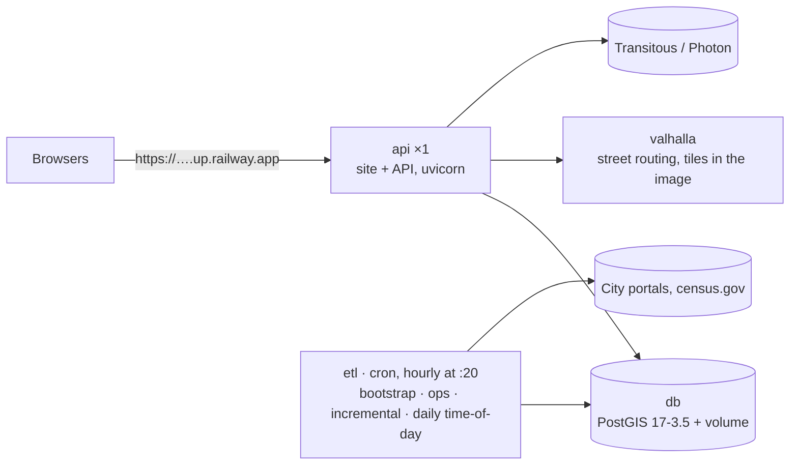

# Railway deployment

The whole site on [Railway](https://railway.com) from one command, with one API instance, a public HTTPS address, and
the data kept current by a scheduled job until the project is deleted. Same backend and frontend as the Kubernetes
deployment (docs/KUBERNETES.md); only how it is hosted differs.

Contents: [What it builds](#what-it-builds) · [Before you start](#before-you-start) · [Deploy](#deploy) ·
[After deploying](#after-deploying) · [Updating](#updating) · [Everyday commands](#everyday-commands) ·
[Taking it down](#taking-it-down) · [How it works](#how-it-works) · [What was tested](#what-was-tested) ·
[Troubleshooting](#troubleshooting)

---

## What it builds



One Railway project, four services, all from this repository:

| Service | Built from | Runs | Volume | Public |
|---|---|---|---|---|
| `db` | `deploy/railway/db.Dockerfile` | PostgreSQL 17 + PostGIS 3.5, as the `safety_app` owner role | `/var/lib/postgresql/data` | no |
| `api` | `Dockerfile` | `deploy/railway/start-api.sh`: wait for the database, migrate, serve. **One replica** | none | **yes** |
| `valhalla` | `deploy/railway/valhalla.Dockerfile` | drive / walk / bike routing, tiles built into the image | none | no |
| `etl` | `Dockerfile` | `deploy/railway/etl_tick.py`, a cron job every hour at minute 20 | `/data` (bronze) | no |

Each city keeps exactly one rolling year of data, as on every other deployment (docs/OPERATIONS.md, "One year of
data").

## Before you start

1. **A Railway account with a payment method.** The database is several GB and the first data load needs a few GB of
   memory for a while, so plan on the Pro plan if Hobby's limits get in the way. Railway bills by use. The always-on
   costs are the database and the API; the `etl` job costs money only while it runs.
2. **An account token.** Create one at [railway.com/account/tokens](https://railway.com/account/tokens) and keep it
   private: it can create and delete projects.
3. **The tools**, on the machine you deploy from:
   - the Railway CLI: `npm i -g @railway/cli` (tested with 5.74.0);
   - `curl`, `jq` and `openssl` (already on most Linux and macOS machines);
   - this repository, checked out on the branch you want to deploy.
4. **Optional:** a Socrata app token ([signup](https://evergreen.data.socrata.com/signup)). Four of the six cities use
   Socrata, which throttles anonymous callers; the first one-year load across them is faster with a token.

## Deploy

From the repository root:

```bash
export RAILWAY_API_TOKEN=<your account token>
export SOCRATA_APP_TOKEN=<optional>
deploy/railway/up.sh
```

That is the whole deployment. The script:

1. creates a Railway project (`safety-map`; change it with `--name`, choose a workspace with `--workspace`) and
   remembers its id in `deploy/railway/.project-id`, which git ignores;
2. creates the four services, the two volumes and every variable, generating the database passwords;
3. sets each service's start command, health check, restart policy and the `etl` cron schedule;
4. uploads this checkout and builds and deploys `db`, `valhalla`, `api` and `etl`, in that order (10–20 minutes, most
   of it the database's first start and the routing tiles download);
5. gives `api` a public `https://….up.railway.app` address and prints it;
6. starts the first `etl` run, which switches on the cities and begins loading their data.

Options:

| Option | Effect |
|---|---|
| `--name <name>` | Project name for a new project (default `safety-map`) |
| `--workspace <id or name>` | Railway workspace for a new project |
| `--cities phl,chi,...` | Which cities the first run switches on (default all six) |
| `--no-routing` | No `valhalla` service: drive, walk and bike directions show as unavailable; the map, transit and search keep working |
| `--config-only` | Re-apply settings and variables without rebuilding anything |

> Austin: docs/DEPLOYMENT.md asks for the City of Austin's reuse terms to be confirmed before `aus` is enabled on a
> new host. To leave it off: `deploy/railway/up.sh --cities phl,chi,sea,lax,dc`.

## After deploying

Open the printed address. The page loads straight away. While the first load runs it shows a progress bar with the
estimated time left, and each city appears on the map as soon as its own load finishes. The whole first load takes
one to a few hours, mostly waiting on the city portals.

From then on, nothing needs doing. Every hour the `etl` job:
- fills in anything an enabled city is missing (`safety.ops`);
- pulls new incidents from each city that is due by its publication cadence;
- deletes anything older than a year;
- once a day, after 04:00 UTC, rebuilds the time-of-day layers the map is coloured by.

The site picks up each new snapshot on its own.

## Updating

Run the same command again from the updated checkout:

```bash
deploy/railway/up.sh
```

It updates the same project in place: settings and variables re-applied, every service rebuilt from the working tree.
The passwords and the data stay as they are. The API migrates the database as it starts, and Railway keeps the old
version serving until the new one passes its health check. Migrations must stay expand/contract, as everywhere else
(docs/DEPLOYMENT.md, "Migrations during a deploy").

Rerunning it also picks up each month's new routing tiles (the script passes the newest release's tag into the
`valhalla` build).

## Everyday commands

Run from the repository root (`up.sh` links the checkout to the project):

| Task | Command |
|---|---|
| Site logs | `railway logs --service api` |
| Data job logs | `railway logs --service etl` |
| Recent data job runs | `railway cron list --service etl` |
| Run the data job now | `railway cron run --service etl --yes` |
| City status, pulls, data quality | `railway ssh --service api -- python -m safety.etl.run status` |
| Turn a city off | `railway ssh --service api -- python -m safety.etl.run enable --city <id> --off` |
| Turn a city on | `railway ssh --service api -- python -m safety.etl.run enable --city <id>` (the next hourly run loads it) |
| Health | `curl -s https://<your address>/api/v1/health` |
| Open the dashboard | `railway open` |

## Taking it down

```bash
deploy/railway/down.sh
```

It asks you to type the project name, then deletes the whole Railway project: every service, both volumes, the
address, and the data. Billing stops with it. It cannot be undone, but running `up.sh` again rebuilds everything,
with the data reloaded from the portals in a few hours. Accounts with two-factor authentication:
`RAILWAY_2FA_CODE=123456 deploy/railway/down.sh`.

---

## How it works

**Why a script and not a Railway config file.**
- Railway's config-as-code files (`railway.toml`/`railway.json`) are deprecated and stop working on 2026-12-01.
- Their successor (`.railway/railway.ts`) has no cron schedule, start command, Dockerfile path or restart policy.
- Railway's public GraphQL API can set all of those. So `up.sh` uses the CLI for what it has commands for (create the
  project, upload code, cron runs) and the API for the rest, including reading what already exists, which is what
  makes reruns safe.

**One `etl` service instead of four jobs.** Kubernetes runs three CronJobs and a bootstrap Job. On Railway that
doesn't work:
- a service has one cron schedule;
- a volume attaches to one service, so four jobs would mean four separate bronze archives.

So `etl_tick.py` fires hourly and decides what is due, running the Kubernetes commands unchanged:

| Kubernetes | Railway (`etl_tick.py`) |
|---|---|
| `safety-bootstrap` Job, once | First tick only: `safety.bootstrap --skip-migrate --skip-converge` enables `BOOTSTRAP_CITIES`, then a marker on the volume stops it repeating. A city switched off later stays off |
| `ops-converge`, hourly | Every tick: `safety.ops` |
| `etl-incremental`, every 6 h | Every tick: `incremental --all --due-only --skip-hourly`. `--due-only` asks each city's cadence, so a city is pulled no more often than before |
| `etl-hourly`, daily 04:00 | Once per UTC day at or after 04:00, remembered on the volume. A day whose 04:20 tick was skipped still gets it |
| ETL advisory lock | Unchanged (`safety/joblock.py`), held for the whole tick |

Railway skips a scheduled run while the last one is still going. A long first load therefore holds off later ticks
by itself, with nothing lost. A failed step doesn't stop the next one, and the run then shows as failed in the
dashboard.

**The database.** It is the same PostGIS image as `docker-compose.yml`, with two additions baked in by
`db.Dockerfile`:
- server settings sized for a database of about 7 GB;
- a first-start script (`db-init.sh`) that creates `safety_app`, a non-superuser that owns the database, as
  CloudNativePG does on Kubernetes.

The image's own init has already created PostGIS by then, so every migration runs as `safety_app`. The superuser
password stays on the `db` service; the other services read `safety_app`'s through a Railway reference
(`${{db.SAFETY_APP_PASSWORD}}`). The data directory is `pgdata/` inside the volume, because a fresh volume is not empty
and `initdb` refuses a non-empty directory.

**One API.** The settings are the Kubernetes ConfigMap's:
- the response cache trusts a city's refresh stamp for 5 s;
- it warms the default layers on start;
- provider budgets are counted in Postgres, so a restart does not refill them.

One uvicorn process carries a few thousand open tabs; the page's map layers are precomputed by the ETL, so a visit is
mostly a cache hit (docs/KUBERNETES.md, "Why this shape"). To grow, raise `numReplicas` in `up.sh`'s `api` settings.
Every setting already supports several replicas.

**Routing tiles in the image.** Kubernetes downloads the tiles in an init container. Railway has none, so
`valhalla.Dockerfile` runs the same verified download (`scripts/fetch_valhalla_tiles.py`) in a build stage. The
server image then starts serving at once.

**Rate limiting.** There is no Traefik or nginx in front, so the app's own limiter
(`safety/api/ratelimit.py`) does the work. It keys on the client address uvicorn takes from Railway's proxy headers;
`FORWARDED_ALLOW_IPS` stays `*`, as on the earlier Railway deployment, because Railway's proxy address range is not
published (see the `Dockerfile` comment for the trade-off).

## What was tested

Verified on 2026-11-14:

- **Locally, with Docker:**
  - The `db` image's first start creates `safety_app`.
  - `start-api.sh` applies all 24 migrations as that non-superuser and serves `/api/v1/health` (HTTP 200) as the
    unprivileged `safety` account.
  - Two `etl_tick.py` runs on a root-owned volume, like Railway's: the first enables the cities and writes its
    marker, the second skips that step. The daily rebuild runs once per day.
  - The `valhalla` image builds with the newest tiles and answers a walking route across central Philadelphia.
- **Against a stand-in Railway CLI and API:**
  - `up.sh` creates, then reruns with no duplicate services, volumes or domains, and keeps its passwords.
  - `down.sh` refuses without the exact project name.
  - Missing or conflicting tokens and API errors stop the script with a clear message.
- **CLI flags:** every flag used matches Railway CLI 5.74.0.
- **The live GraphQL schema** (`railway api schema`): every query, mutation, argument, input field and enum value
  `up.sh` sends exists with a matching type, including the volume and domain listings.

Not yet verified against a live Railway project:
- the exact JSON `railway init --json` prints (the script tries `.id`, `.projectId` and `.project.id`, then falls back
  to `railway status --json`);
- whether a custom start command keeps the image's entrypoint (the start commands call it explicitly, so it works
  either way);
- `railway ssh` running a one-off command as written above.

The first real `up.sh` is the remaining test. If it fails partway, fix the cause and run it again, or `down.sh` and
start over.

## Troubleshooting

| Symptom | Likely cause | Fix |
|---|---|---|
| `up.sh: unset RAILWAY_TOKEN` | A project token is set in the shell | `unset RAILWAY_TOKEN`; the script needs the account token only |
| `Railway API: Not Authorized` | The token is wrong, expired or a project token | Make a new account token at railway.com/account/tokens |
| `api` logs `database not ready (attempt N/600)` for minutes | The database's first start (initdb) | Wait; the API waits up to 20 minutes and its health check allows 25 |
| `api` crash-loops with `password authentication failed` | The `db` volume was initialised with other passwords | Don't change `SAFETY_APP_PASSWORD` by hand; on a brand-new project, `down.sh` and `up.sh` |
| Map empty, progress bar never appears | The first `etl` run hasn't started | `railway cron run --service etl --yes`, then `railway logs --service etl` |
| `etl` run shows failed | One step failed (often a city portal's bad day) | `railway logs --service etl`; the next hourly run retries |
| Directions say drive/walk/bike unavailable | `valhalla` is down or was skipped with `--no-routing` | `railway logs --service valhalla` |
| `429 Too Many Requests` | The per-client rate limit, working as intended | Nothing; normal use never reaches it |
