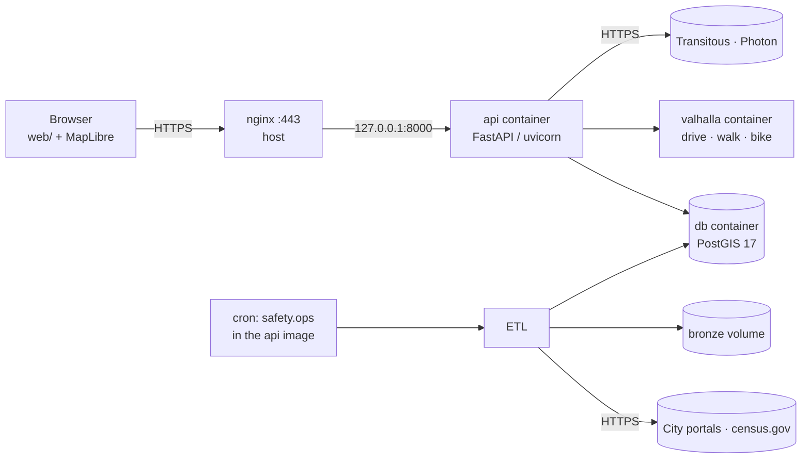

# Crime Prevention & Personal Safety Application

A public web map of **relative reported-crime activity** in roughly 500 m hexagonal cells, built from official
incident-level open data for six US cities: Philadelphia, Chicago, Seattle, Los Angeles, Washington DC and Austin.
Plus safety-aware directions in four modes.

It runs as three containers on any Linux host with Docker: PostGIS, the API (which also serves the frontend), and a
self-hosted Valhalla routing service, with nginx in front for TLS.

| Document | Read it for |
|---|---|
| **this README** | What the system is, how it is put together, configuration, local development, troubleshooting, known gaps |
| [DEPLOY.md](DEPLOY.md) | Deploying on a bare Linux server: requirements, host packages, first load, routing tiles, nginx and TLS |
| [CLAUDE.md](CLAUDE.md) | The authoritative component inventory, the end-to-end HTTP verification, the test-suite breakdown, and the Git record of what changed and why |
| [docs/DESIGN.md](docs/DESIGN.md) | The original system design document — the requirements spec the `F4`–`F20` and `S6`/`S13` identifiers in the code comments refer to |

Figures in this README marked *(measured)* were observed on a verified clean-install run; see
[CLAUDE.md](CLAUDE.md) for the method and its limits.

---

## 1. Overview

**Who uses it.** Residents, commuters and visitors who want to know whether an area is typically quieter or busier
than others nearby, and researchers who want a documented API.

**What it shows.** Every covered city on one map, over the last year and nothing else: each city keeps one rolling
year of incidents and deletes anything 366 or more days old.

- Each H3 cell is coloured by its relative risk: its rate as a multiple of its own city's average, at the hour and
  weekday it is now in that city. **Cities are never compared with each other**, because reporting differs too much
  between police departments. Tapping a cell shows that rating and the cell's 24-hour and 7-day patterns.
- A severity-weighted "safety" ranking per 1,000 residents plus jobs, kept as two separate rankings: violent and
  non-violent.
- Time-of-day rankings: a cell's rate is multiplied by its hour factor and its weekday factor, blended toward the
  city's pattern when the cell has little data, and every cell is ranked again at that time.
- While a city's first load runs, a progress bar on the map shows how far it has got (`GET /api/v1/progress`).

It deliberately does not give an address-level "risk score".

**Directions.** Driving, walking, biking and transit directions between two addresses, each route annotated with how
much reported activity there is *along it* compared with the city average, plus a "lower reported activity"
alternative when one is clearly lower for a few extra minutes. It is a relative description of a route, never a score
for an address. Driving, walking and biking use the self-hosted Valhalla container, whose OpenStreetMap tiles are
built monthly in GitHub Actions and downloaded by `deploy/valhalla/fetch.sh`; transit uses the public Transitous
service and address search uses Photon, both called by the server, never the browser.

**In one paragraph.** A Python ETL (`safety/etl`) pulls each city's incidents from its open-data portal, stores the
raw responses on disk ("bronze"), normalizes them into one PostGIS table ("silver"), and rebuilds per-cell rollups
("gold"). A FastAPI app (`safety/api`) serves those rollups read-only under `/api/v1`, together with a vanilla-JS
MapLibre frontend (`web/`). Nothing in the request path aggregates: the ETL and the API only ever meet through the
database.

## 2. Architecture



| Component | Tech | Responsibility | Port |
|---|---|---|---|
| Web frontend | Vanilla JS, MapLibre GL 5.9.0, h3-js 4.2.1 — **vendored, served from this origin** | Map UI | served at `/` by the API |
| API | FastAPI 0.141.1 / uvicorn 0.52.4 | Read-only `/api/v1/*` over `gold` tables; static files | `127.0.0.1:8000` |
| ETL + ops | Python CLIs `safety.etl.run`, `safety.ops`, `safety.bootstrap` | Portal → bronze → silver → gold | — |
| Database | `postgis/postgis:17-3.5` | Everything persistent | `127.0.0.1:55432` |
| Routing | `ghcr.io/valhalla/valhalla:3.9.1` (digest-pinned) | Street routing, behind the `routing` profile | `127.0.0.1:58002` |
| Reverse proxy | nginx + certbot, on the host | TLS, rate limits, gzip | 80, 443 |

The API and the ETL are the **same image** with a different command, because they run identical code and differ only
in entry point.

Data flow:
1. A portal returns incidents, which are saved to `BRONZE_ROOT/…`.
2. Records are normalized and validated, then upserted into `silver.incident`.
3. `gold.*` is rebuilt and `gold.city_snapshot.last_refreshed_at` is set to now.
4. The API cache and the browsers' 60 s poll notice that timestamp and reload.

## 3. Tech stack

| Layer | Technology | Version | Notes |
|---|---|---|---|
| Language | Python | 3.12 | Every compiled dependency ships a cp312 manylinux wheel, so the image builds with no compiler *(measured)* |
| Web | FastAPI, uvicorn[standard] | 0.141.1, 0.52.4 | One process; `/docs` when `ENABLE_DOCS` |
| DB access | psycopg[binary,pool] | 3.3.5 | Sync pool (API), COPY (ETL) |
| Config | pydantic-settings | 2.15.0 | Env vars + `.env` |
| Geo | h3, pyproj, pyshp | 4.5.0, 3.7.2, 3.1.6 | H3 is computed in Python, not in the DB |
| HTTP client | httpx | 0.28.1 | Portal downloads, routing providers |
| Database | PostgreSQL + PostGIS | 17 / 3.5 | All state except bronze |
| Frontend | MapLibre GL JS, h3-js | 5.9.0, 4.2.1 | Vendored under `web/vendor/`; see [Security](#11-security) for the MapLibre advisory |
| Routing | Valhalla | 3.9.1 | Self-hosted; tiles built in CI |
| Containers | Docker Engine + Compose v2 | 25+ | The only runtime requirement on the host |
| CI | GitHub Actions | `ubuntu-latest` | One job named `ci` |
| Tests | pytest, `node --test` | 9.1.1, Node 22+ | 546 tests *(measured)* |

Only the 8 top-level Python packages are pinned (`requirements.txt`). Indirect dependencies are not pinned and there
is no lockfile.

## 4. Repository layout

182 tracked files. The repository was pruned to the running service; `CLAUDE.md` section 5 records what was removed
and why, and the history holds all of it.

```
safety/                     Python package (52 files)
  config.py                 every setting (pydantic); REPO_ROOT-relative paths
  db.py                     connections, wait_for_db, silver partition management
  h3grid.py                 lat/lng → H3 cell (res 8/9/10)
  migrate.py                `python -m safety.migrate`: SQL migrations + CSV reference loads
  ops.py                    `python -m safety.ops`: load whatever each enabled city is missing
  bootstrap.py              `python -m safety.bootstrap`: migrate → enable → converge, the first load
  api/main.py               FastAPI app, 9 routes, response cache, static mount
  api/directions.py         the 4 directions / geocoding routes
  api/repository.py         every SQL query the API runs
  api/ratelimit.py          in-process token-bucket limiter
  api/security.py           CSP / HSTS / security-header middleware
  etl/run.py                `python -m safety.etl.run`: backfill, incremental, reprocess, census,
                            release-geometry, gold, prune, safety, hourly, safety-compare, enable,
                            weights, status, log
  etl/adapters/             one adapter per city (Carto, Socrata, Esri ArcGIS)
  etl/                      bronze · transform · validate · gold · census · boundary · withdrawn · retention
  routing/                  providers, scoring, detours, circuit breaker, daily budgets
db/migrations/              001–024, forward-only, checksummed, immutable
reference/crosswalk/        per-city offense code → NIBRS/UCR/category CSVs (loaded on every migrate)
reference/severity/         severity schemes and weights
web/                        index.html, app.js, directions.js, html.js (escape-by-default), styles.css, sw.js
web/vendor/                 maplibre-gl.js/.css, h3-js.umd.js — vendored, no CDN at runtime
tests/                      pytest (unit + `db`-marked) and tests/js (node --test)
deploy/
  nginx/safety.conf         the production front end: rate-limit zones, gzip, proxy headers
  valhalla/                 fetch.sh (install tiles), smoke.sh (route every city), build.sh (runs in CI), regions.tsv
  lib/smoke.sh              the end-to-end HTTP check, used by CI and by DEPLOY.md
docker-compose.yml          the three services: db, api, valhalla (profile `routing`)
Dockerfile                  the API/ETL image
.github/workflows/          ci.yml (the test gate), valhalla-tiles.yml (monthly tile release)
docs/DESIGN.md              the original design document
```

## 5. Prerequisites

| For | You need |
|---|---|
| The server | Any Linux host with Docker Engine 25+ and Compose v2, plus nginx and certbot for TLS. 2 vCPU / 4 GB RAM minimum, 25 GB disk. Full list and the exact apt sequence: [DEPLOY.md](DEPLOY.md#1-requirements) |
| Local development | Python **3.12**, Docker with Compose v2, Node 22+ for the JS tests, and internet access — there is no offline sample dataset. Optional: `shellcheck` |
| Access | GitHub push access to the repository. For a public deployment: a domain, and ports 80/443 reachable |

Docker needs either root or membership in the `docker` group. On a host where you have neither, see the note at the
end of [Known gaps](#known-gaps).

## 6. Configuration

All application settings live in `safety/config.py`. They are read once at process start, with real environment
variables taking precedence over `REPO_ROOT/.env`, which takes precedence over the code default. Names are
case-insensitive and unknown keys are ignored. Use plain `KEY=value` lines: no quotes, no `export`.

`POSTGRES_PASSWORD` is the **only** value with no default — deliberately, so that a well-known password cannot reach
a deployment. `dsn` refuses to build without it, at connect time, so imports and DB-free tests still work.

| Variable | Default | Required | Purpose |
|---|---|---|---|
| `POSTGRES_PASSWORD` | *(none)* | **yes** | DB password. Use `openssl rand -base64 36`; it is not URL-escaped, so avoid `@:/?#` |
| `POSTGRES_DB` · `POSTGRES_USER` | `safety` · `safety` | — | Database and role |
| `POSTGRES_HOST` | `127.0.0.1` | — | Keep the IPv4 literal: `localhost` resolves to `::1` first and the pool times out. **Compose overrides this to `db`** for the API container |
| `POSTGRES_PORT` | `55432` | — | Host-published port; compose overrides to `5432` inside the network |
| `API_PORT` | `8000` | — | Host port compose publishes on loopback |
| `BRONZE_ROOT` | `REPO_ROOT/data/bronze` | — | Raw pull storage. Compose sets `/data/bronze`, a named volume |
| `RETENTION_DAYS` | `365` | — | Days of incidents each city keeps; older rows and bronze pulls are deleted and never refetched |
| `BACKFILL_MONTHS` | `12` | — | Backfill window, clamped to the retention cutoff |
| `BOOTSTRAP_CITIES` | all six | — | Which cities `safety.bootstrap` enables. Drop `aus` to leave Austin off (see [Known gaps](#known-gaps)) |
| `ENABLE_DOCS` | `true` | — | Serves `/docs`, `/redoc`, `/openapi.json` |
| `ENABLE_RATE_LIMIT` | `true` | — | In-app limiter. Set `false` only locally or for load tests |
| `CACHE_MAX_ENTRIES` · `CACHE_MAX_BYTES` | `192` · 256 MiB | — | Response cache bounds. The byte budget is what protects the container |
| `API_STATEMENT_TIMEOUT_MS` | `15000` | — | Per-query limit on API connections; over it, 503 |
| `API_POOL_TIMEOUT_SECONDS` · `API_POOL_MAX_SIZE` | `10` · `8` | — | Wait for a pool slot before 503; connections per process |
| `HSTS_MAX_AGE_SECONDS` | `86400` | — | HSTS, sent on https only |
| `HTTP_TIMEOUT_SECONDS` · `HTTP_MAX_RETRIES` | `120` · `4` | — | Portal requests |
| `CARTO_MAX_RETRIES` | `6` | — | Philadelphia (Carto) gets more attempts; its endpoint has bad patches of a few minutes |
| `CONNECT_TIMEOUT_SECONDS` | `10` | — | libpq `connect_timeout`; without it a dead address costs the OS TCP timeout |
| `MIGRATE_LOCK_WAIT_SECONDS` | `600` | — | Wait for a concurrent migrate |
| `SOCRATA_APP_TOKEN` | *(empty)* | — | Optional, free. Identifies the caller for quota on the four Socrata cities (chi, sea, lax, aus). Everything works without it |
| `OPS_CITY` · `OPS_FORCE` · `OPS_DRY_RUN` | empty · false · false | — | Steer `safety.ops`; CLI flags win |
| `OPS_RETRY_COOLDOWN_HOURS` | `6` | — | How long a failed ops step is left alone |
| `WITHDRAWN_RECONCILE` · `WITHDRAWN_RETENTION_DAYS` | `report` · `90` | — | `off`/`report`/`delete` for rows that vanish upstream, and how long deleted rows stay recoverable |
| `DIRECTIONS_ENABLED` | `true` | — | Kill switch for directions and address search. Off: the endpoints answer 503 and the page hides the button |
| `VALHALLA_URL` | `http://127.0.0.1:58002` | — | **Compose overrides to `http://valhalla:8002`** |
| `VALHALLA_PORT` · `VALHALLA_DATA_DIR` | `58002` · `/srv/valhalla/current` | — | Read by compose for the `valhalla` service only |
| `TRANSITOUS_URL` · `TRANSITOUS_PLAN_PATH` | `https://api.transitous.org` · `/api/v6/plan` | — | Public transit planner |
| `PHOTON_URL` | `https://photon.komoot.io` | — | Public address search |
| `ROUTING_CONTACT` | the repo URL | — | Contact in every upstream User-Agent, as Transitous and Photon ask |
| `ROUTING_TIMEOUT_SECONDS` | `8` | — | Per upstream call |
| `TRANSIT_DAILY_BUDGET` · `GEOCODE_DAILY_BUDGET` | `500` · `5000` | — | Upstream calls per UTC day; Transitous asks for under 720 a day from us |
| `ROUTE_MAX_KM` | `100` | — | Longest straight-line trip accepted; above every city's bbox diagonal (LA 84.5 km) |
| `PORT` · `FORWARDED_ALLOW_IPS` | `8000` · `*` | — | Read by the image's `CMD`. Compose sets `FORWARDED_ALLOW_IPS=127.0.0.1`, since nginx is the only hop to trust. The default `*` lets a client spoof its address, which the rate limiter keys on |

Also present but unused by this deployment: `DB_SHARDS`, `SHARD_CITIES`, `JOBLOCK_HOST`, `JOBLOCK_WAIT_SECONDS`,
`ROUTING_BUDGET_BACKEND`, `CACHE_STAMP_TTL_SECONDS`, `CACHE_WARM_ON_START`. They exist for a multi-replica,
multi-database deployment; a single API container needs none of them. `SAFETY_TEST_DB=1` enables the `db`-marked
tests, and `SMOKE_TIMEOUT` (60) is read by `deploy/lib/smoke.sh`.

**Secrets.** The only application secret is the database password, in `.env` (mode 0600). TLS keys are managed by
certbot under `/etc/letsencrypt`. CI uses a throwaway literal password and no GitHub secrets. None of this is backed
up anywhere — see [Known gaps](#known-gaps).

## 7. Local development

```bash
git clone https://github.com/ryanfio15/Crime-Prevention-and-Personal-Safety-Application.git
cd Crime-Prevention-and-Personal-Safety-Application

cp .env.example .env
sed -i "s/^POSTGRES_PASSWORD=.*/POSTGRES_PASSWORD=$(openssl rand -hex 32)/" .env
echo "ENABLE_RATE_LIMIT=false" >> .env          # optional, local only

docker compose build api
docker compose up -d db                          # PostGIS on 127.0.0.1:55432
docker compose run --rm api python -m safety.bootstrap --cities phl
docker compose up -d api
# open http://127.0.0.1:8000/   ·   API docs at http://127.0.0.1:8000/docs
```

`bootstrap` applies the 24 migrations, enables the city, and runs the first load. A one-city, one-month load took
about three minutes *(measured)*; the full six-city, twelve-month load is hours, most of it waiting on portals. For a
quicker smoke, add `-e BACKFILL_MONTHS=1` to the `run` command.

To work on the Python outside a container:

```bash
python3.12 -m venv .venv
.venv/bin/pip install -r requirements-dev.txt    # requirements.txt + pytest
.venv/bin/python -m uvicorn safety.api.main:app --reload --port 8000
```

- **The API will not start usefully without a reachable database.** `wait_for_db` retries 30 times at 2 s intervals,
  so up to 60 s. Against an unmigrated database it starts, but every data route returns 500.
- Only **Philadelphia** is enabled by the migrations. For another city:
  `python -m safety.etl.run enable --city chi`, then `python -m safety.ops --city chi`.
- There is no sample dataset: the first load is a live pull from the portal.
- `--reload` restarts on Python changes, and `web/` is served from disk with no build step.
- A smaller load with `--months` is never widened later by `incremental` or `ops`. Run `backfill` again without
  `--months` for the full year.

### Tests

546 tests, all passing *(measured)*: 413 Python without a database, 58 marked `db`, 75 JS.

```bash
python -m pytest -q -m "not db"                       # 413
SAFETY_TEST_DB=1 python -m pytest -q -m db            # 58, needs live PostGIS
node --test tests/js/*.test.mjs                       # 75; the glob is required
node --check web/app.js                               # one file per call
for f in deploy/lib/smoke.sh deploy/valhalla/*.sh; do bash -n "$f"; done
shellcheck deploy/lib/smoke.sh deploy/valhalla/*.sh
```

**DB tests are destructive.** `tests/test_gold_invariants.py` deletes every phl incident and the phl boundary, commits
synthetic data, and restores nothing. Run them only against a throwaway database — a second compose project with its
own ports is the easy way.

**Do not run the `db` tests while an ETL is running.** `tests/test_joblock.py` takes the real ETL advisory lock; if
`safety.ops`, `bootstrap` or an ETL holds it, two tests fail with `assert 75 == 3`. That is lock contention, not a
defect.

There is no Python or JS linter or formatter configured. Only shell is linted, with shellcheck.

## 8. Deployment

**[DEPLOY.md](DEPLOY.md)** is the guide: host packages, clone, `.env`, build, `safety.bootstrap`, routing tiles,
nginx and certbot, and the smoke check. In short:

```bash
sudo docker compose build api
sudo docker compose up -d db
sudo docker compose run --rm api python -m safety.bootstrap   # hours, for all six cities
sudo docker compose up -d api
sudo deploy/valhalla/fetch.sh                                 # ~1.2 GB of routing tiles
sudo docker compose --profile routing up -d valhalla
sudo SMOKE_TIMEOUT=60 deploy/lib/smoke.sh 8000 -              # → "smoke ok on :8000"
```

Valhalla sits behind a compose profile deliberately: a plain `docker compose up -d` never starts it, and nothing about
a deploy depends on routing. With it down, the map and transit directions carry on and drive/walk/bike report
themselves unavailable.

**Nothing is scheduled by the deploy.** Two cron entries cover ongoing operation — `safety.ops` six-hourly to refresh
data, and `deploy/valhalla/fetch.sh` weekly for tiles. Both are in [DEPLOY.md](DEPLOY.md#7-keeping-data-fresh).

**Updating.** `git pull`, `docker compose build api`, `docker compose run --rm api python -m safety.migrate`, then
`docker compose up -d api`. Migrations are forward-only and are never undone, so a release must keep working on the
migrated schema. Expect a few seconds of 502 during the restart.

## 9. Networking

| Bind | What | Exposure |
|---|---|---|
| `:80`, `:443` | nginx | Public; 80 redirects and serves certbot renewals |
| `127.0.0.1:8000` | API | Loopback only |
| `127.0.0.1:55432` → 5432 | PostGIS | Loopback only |
| `127.0.0.1:58002` → 8002 | Valhalla | Loopback only |

Everything but nginx is bound to loopback, and deliberately: Docker writes its own iptables rules ahead of UFW, so
publishing on `0.0.0.0` would expose Postgres to the internet while `ufw status` still claimed the port was blocked.

- **TLS**: Let's Encrypt via `certbot --nginx`, renewed by `certbot.timer`.
- **Rate limiting**: two layers. nginx caps `/api/v1/cells` at 2 r/s (burst 10) and the rest of `/api/v1/` at 10 r/s
  (burst 20), with at most 20 concurrent connections per address; the app has its own per-client limiter.
- **Proxy trust**: uvicorn trusts `X-Forwarded-For` from `127.0.0.1` only.
- **CORS**: none (same origin). **Security headers**: set by the app.
- **Outbound**: phl.carto.com, three Socrata portals, DC and Austin ArcGIS, census.gov, api.transitous.org,
  photon.komoot.io, GitHub (tiles), PyPI and Docker Hub (builds).
- **From the browser**: this origin only, plus `basemaps.cartocdn.com` for basemap imagery. MapLibre and h3-js are
  vendored, so no CDN is needed to render the map.

If you put another proxy in front (a tunnel, a load balancer), set `real_ip_header`/`set_real_ip_from` in
`deploy/nginx/safety.conf` and match `FORWARDED_ALLOW_IPS` — otherwise every client lands in one rate-limit bucket.

## 10. Data & persistence

- **Stores**: PostGIS (`reference`, `etl`, `silver`, `gold` schemas) in the `safety_db_data` volume; raw bronze files
  in the `safety_bronze` volume, pruned to the same one-year cutoff; an in-process API cache.
- **Migrations**: `python -m safety.migrate` — 24 checksummed, forward-only files under an advisory lock. Every run
  also reloads the crosswalk and severity CSVs (1,224 crosswalk rows, 2 schemes, 66 weights *(measured)*).
  **Applied migrations are immutable**: editing one that has run is a `MigrationChecksumError`.
- **Size**: Philadelphia alone, at 38,076 incidents for a rolling year, was 234 MB of bronze and 157 MB of database
  *(measured)*. Chicago and Los Angeles are several times that. Routing tiles are ~1.2 GB installed.
- **Backups**: **none are configured.** See [Known gaps](#known-gaps).
- **Loss**: losing the `safety_db_data` volume loses all data. It reloads from the cities' public sources with
  `safety.bootstrap`, which takes hours, and records a city has since withdrawn do not come back.

## 11. Security

- **Authentication**: none, by design. The API is read-only (GET, plus POST for geocoding and route *requests*) over
  aggregated public data. No accounts, cookies or writes.
- **Controls**:
  - two layers of per-client rate limiting (nginx and the app) — the only thing standing between a stranger and a
    repeated full-city layer build;
  - pool and statement timeouts that return 503 rather than hanging every endpoint;
  - parameterized SQL throughout;
  - escape-by-default HTML in the frontend (`web/html.js`);
  - a CSP that permits **no third-party script or style origin at all**, plus `nosniff`,
    `X-Frame-Options: DENY` and HSTS;
  - least privilege in the containers: the API drops root at entry, and Valhalla runs as `nobody`, read-only, with
    all capabilities dropped and no new privileges.
- **Trust boundary**: internet → nginx → uvicorn on loopback → Postgres on loopback.

Known concerns, recorded and not fixed:

- **MapLibre 5.9.0 has a critical XSS advisory** (GHSA-jrc7-96c5-q579). Vendoring the library changed where it is
  served from, not which version it is. Whether the vulnerable sanitizer is reachable from this application has not
  been established. Upgrading MapLibre is the outstanding fix.
- **The API connects as the database owner role.** `POSTGRES_USER` is created by the PostGIS image as a superuser, so
  the application has more rights than it needs. The previous host deployment split this into a separate
  non-superuser owner role; the container deployment does not.
- Indirect Python dependencies are unpinned and there is no lockfile.
- `/docs` is public when `ENABLE_DOCS` is on. It is a kill switch for unwanted attention, not a security control —
  the frontend names every endpoint in plain JavaScript anyway.
- There is no branch protection on `main`.

## 12. Observability & operations

- **Logs**: `docker compose logs -f api`, and `python -m safety.etl.run log` for the ETL's own history of every pull
  and ops step.
- **Health**: `/api/v1/health` proves the database is reachable and reports the incident count and the deployed
  commit. It does not check data freshness — `/api/v1/quality` and `/api/v1/cities` carry per-city staleness.
- **Progress**: `/api/v1/progress` while a backfill runs.
- **Metrics, tracing and alerting**: none. Nothing pages anyone, and nothing watches certificate expiry.
- **Scaling**: one uvicorn process, a pool of 8, a 256 MiB response cache. Valhalla is capped at 1.5 GB and 1.5 CPU.

## 13. Troubleshooting

| Symptom | Cause | Fix |
|---|---|---|
| `required variable POSTGRES_PASSWORD is missing a value` | No password in `.env`; there is no default | Set `POSTGRES_PASSWORD` |
| `RuntimeError: POSTGRES_PASSWORD is not set` | Same, raised lazily at the first connection | Set it |
| `permission denied ... /var/run/docker.sock` | Your user is not in the `docker` group | `sudo usermod -aG docker $USER`, then log out and back in — or prefix commands with `sudo` |
| `PoolTimeout: pool initialization incomplete` | DB down, wrong `POSTGRES_*`, or `POSTGRES_HOST=localhost` (tries `::1`; the DB listens on IPv4) | Use `127.0.0.1`; `docker compose ps`; check `.env` |
| `/api/v1/health` returns 500, "relation … does not exist" | Schema not migrated | `docker compose run --rm api python -m safety.migrate` |
| API healthy but the map is empty | The first load has not finished | Watch `/api/v1/progress`; check the bootstrap's exit status and re-run it — it is idempotent |
| `bind: address already in use` on 55432 / 8000 | Another stack on the same host | Change `POSTGRES_PORT` / `API_PORT` |
| `backfill --city chi`: "source 'chi' is disabled" | Only phl is enabled by the migrations | `python -m safety.etl.run enable --city chi` |
| `MigrationChecksumError` | An already-applied migration file was edited | Revert the edit and add a new migration instead |
| drive/walk/bike report "unavailable" | Valhalla is down or has no tiles | `/api/v1/directions/status` says which; run `deploy/valhalla/fetch.sh`, then start the `routing` profile |
| `bind source path does not exist` starting valhalla | The tile directory does not exist yet; it is deliberately not auto-created | Run `deploy/valhalla/fetch.sh` first |
| Directions return 422 `{"code":"outside"}` | Both endpoints must be inside one covered city's bbox | Expected; check `/api/v1/cities` for the bbox |
| `429 Too Many Requests` | Rate limit (cells 2 r/s, others 10 r/s per client) | Expected; locally set `ENABLE_RATE_LIMIT=false` |
| Many 429s under light use, behind another proxy | Every client shares one bucket because `$binary_remote_addr` is the proxy | Set `real_ip_header` / `set_real_ip_from` in the nginx config |
| 503 with `Retry-After` | Pool saturated, or a query over `API_STATEMENT_TIMEOUT_MS` | Check for a long migration or ETL |
| Browser console: CSP blocked a script or style | A new third-party origin, which the policy now forbids outright | Vendor the asset, or add the origin to `APP_CSP` deliberately |
| Map draws hexagons but no basemap | `basemaps.cartocdn.com` unreachable | Network issue; the data layer is unaffected |
| Two `test_joblock` failures (`assert 75 == 3`) | An ETL holds the real advisory lock | Wait for it to finish, then re-run |
| `node --test tests/js/` fails with `Cannot find module` | Node needs files, not a directory | `node --test tests/js/*.test.mjs` |

## Known gaps

1. **No backups.** The previous deployment had a nightly `pg_dump` driven by systemd; that machinery was removed with
   the rest of the host-specific deploy and **has not been replaced**. A `pg_dump` from the `db` container on a cron
   schedule, written off-host, is the gap to close. Database dumps must never go into this public repository, and the
   `.env` password belongs in a password manager.
2. **Austin licensing (deferred).** `db/migrations/016_onboard_austin.sql` says Austin must stay disabled until the
   City confirms its CrimeViewer services may be reused, but `BOOTSTRAP_CITIES` enables all six by default. Drop `aus`
   from it if that confirmation has not been obtained. Note that `enable --city aus --off` only stops *loading*: the
   API lists every city that has a `gold.city_snapshot` row, enabled or not.
3. **MapLibre advisory** — see [Security](#11-security).
4. **nginx and TLS are the least-verified step.** Every other part of `DEPLOY.md` was executed end to end on a clean
   install; section 5 was transcribed from the config's install header and a working host. Expect to debug it.
5. **The full six-city load has never been run end to end here.** One city at one month is proven *(measured)*; the
   hours and the multi-city disk figures are extrapolations.
6. **No alerting, metrics or uptime checks**, and nothing watches certificate expiry.
7. **Dangling documentation references.** Surviving code comments still cite documents that were pruned
   (`docs/PHASE2.md`, the old `docs/DEPLOY.md`, `docs/KUBERNETES.md`, `docs/OPERATIONS.md`, `docs/DEPLOYMENT.md`).
   The comments are substantial and were kept; the citations point at nothing. `docs/DESIGN.md` references are live.
8. **Deploying without root.** Docker needs root or `docker`-group membership. Rootless Docker is the alternative, but
   it needs the `uidmap` package and a `/etc/subuid` range for your user, both of which only an administrator can
   provide. Without one of those, this stack cannot run — and even then, binding 80/443 for public TLS needs either
   an administrator or a tunnel.
